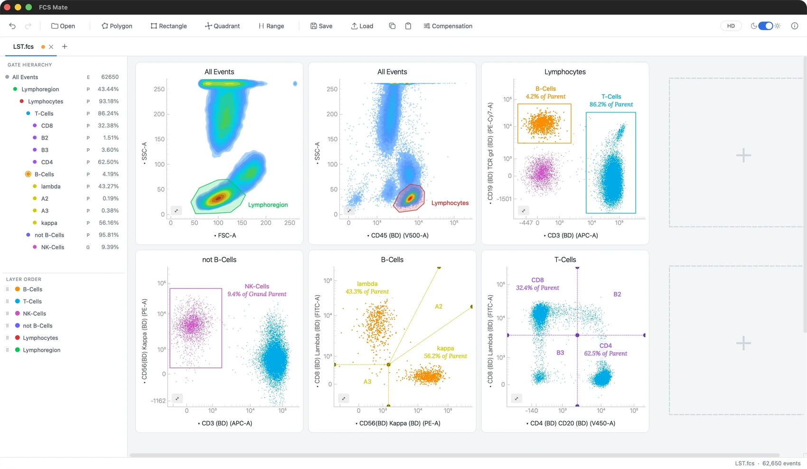
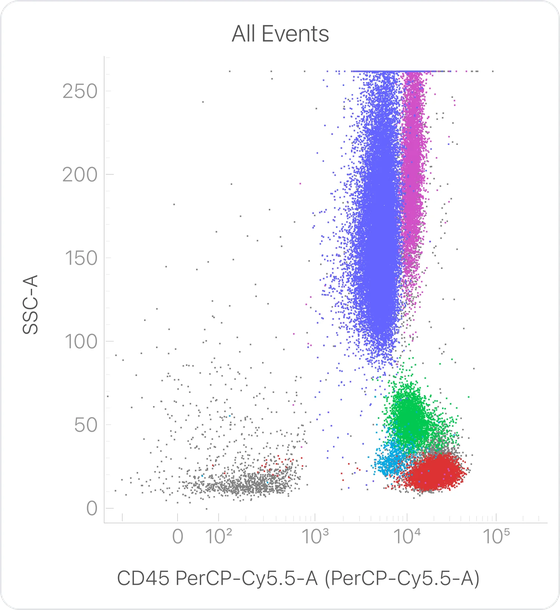
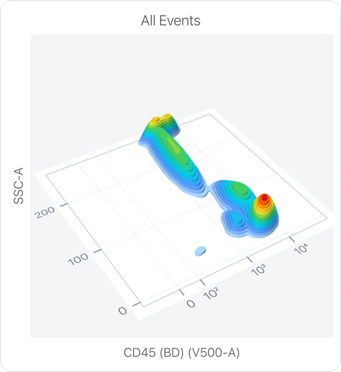
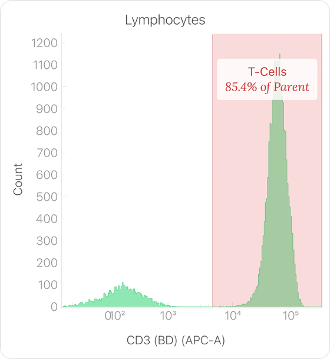
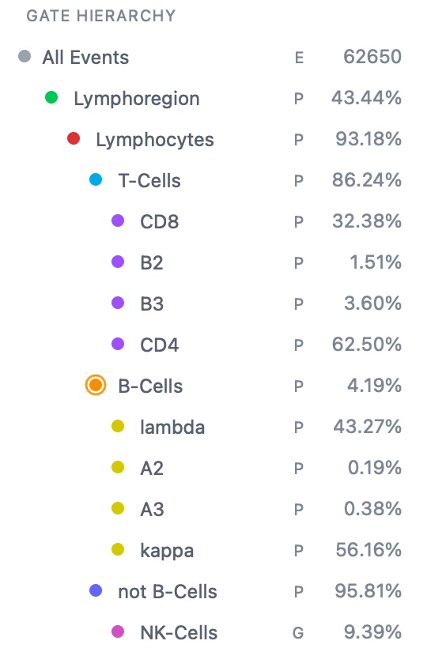

  <picture>
    <source media="(prefers-color-scheme: dark)" srcset="images/banner-dark.png">
    
  </picture>

  
  
  

  Always the latest version. The macOS build is for Apple Silicon. 
  Older versions and release notes: <a href="https://github.com/devdoc76/fcs-mate-releases/releases">Releases</a> · All details and demos: <a href="https://fcsmate.app"><b>fcsmate.app</b></a>

  <picture>
    <source media="(prefers-color-scheme: dark)" srcset="images/hero-dark.png">
    
  </picture>

## What it does

<table>
  <tr>
    <td align="center" valign="top" width="33%">
       
      <b>2D plots</b> 
      Dot, density and contour plots with linear, log or logicle axes
    </td>
    <td align="center" valign="top" width="33%">
       
      <b>3D plots</b> 
      3D contour and 3D dot plots you can rotate, export as .glb or .obj
    </td>
    <td align="center" valign="top" width="33%">
       
      <b>Histograms</b> 
      With range gates and statistics if required
    </td>
  </tr>
</table>

<table>
  <tr>
    <td valign="top" width="300">
      <picture>
        <source media="(prefers-color-scheme: dark)" srcset="images/hierarchy-dark.png">
        
      </picture>
    </td>
    <td valign="top">
      <b>Gating that keeps up with you</b>
      <ul>
        <li>Polygon, rectangle, quadrant and range gates</li>
        <li>Gate hierarchy and layer order, custom colors, inverted gates</li>
        <li>Events, % of total, % of parent, % of grandparent and MFI (or median) in the hierarchy and inside the plot</li>
      </ul>
      <b>And more</b>
      <ul>
        <li>Axes: linear, log and logicle (biexponential) with an adjustable width</li>
        <li>Manual compensation with a live preview</li>
        <li>Save, load, copy and paste protocols</li>
        <li>Open several FCS files, merge tubes into one, anonymize files</li>
        <li>Export as PNG, JPEG, TIFF (up to 1200 dpi) or SVG</li>
        <li>Light and dark theme</li>
      </ul>
    </td>
  </tr>
</table>

## Installation

> [!NOTE]
> The apps are not code-signed, so your system shows a warning the first time. That is expected.

<b>macOS</b>

1. Unzip `FCS-Mate-macOS.zip` and drag *FCS Mate* into your Applications folder.
2. On the first start, right-click the app and choose **Open**, then confirm.
   If macOS still refuses, run this once in the Terminal: `xattr -dr com.apple.quarantine "/Applications/FCS Mate.app"`

   Sometimes it is required to go to **Settings**, **Privacy & Security**, scroll down and click on **Open Anyway**.

<b>Windows</b>

1. Run `FCS-Mate-Windows.exe`. No installation is needed.
2. If Windows SmartScreen appears, click **More info**, then **Run anyway**.

<b>Linux</b>

1. Unpack with `tar xzf FCS-Mate-Linux.tar.gz`.
2. Start with `./FCS-Mate`.

## Intended use and disclaimer

For private use only. Not a medical device. Not for clinical or diagnostic use. The author accepts no liability for analyses, results or conclusions drawn from this software, including diagnostic conclusions.

## About

Designed and directed by Dr. Georg Slavka.

This repository only hosts the finished builds. The source code is not public.

## Support

FCS Mate is free. If it helps your work, you can support its development with a voluntary donation on [Ko-fi](https://ko-fi.com/fcsmate). Donations are entirely optional and do not include support, a warranty or any change to the terms above.
